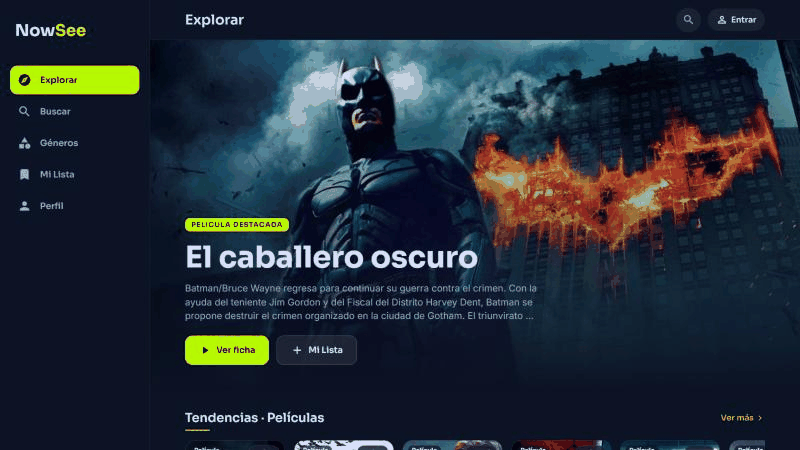
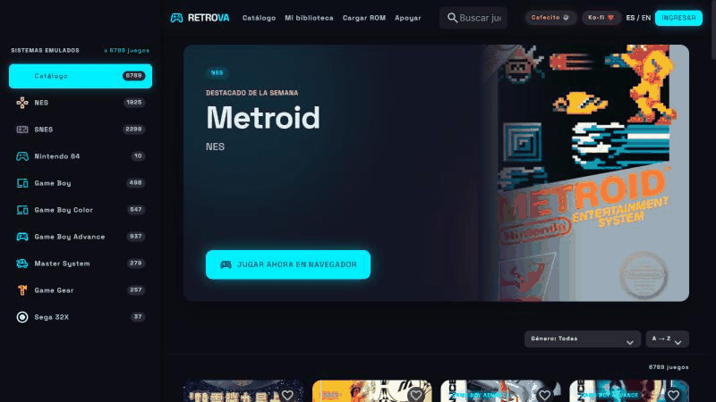
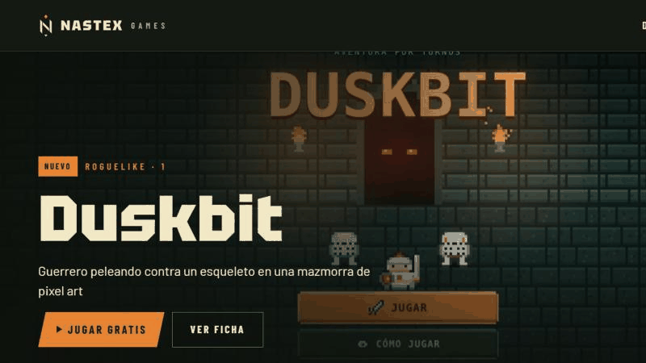
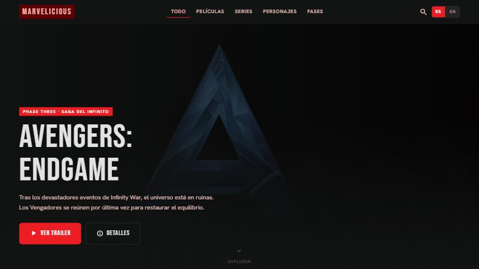

  

 

## 👋 Sobre mí

Construyo cosas que funcionan: desde pipelines y dashboards hasta automatizaciones con IA y apps web completas, de punta a punta.

Vengo de **4 años como analista e ingeniero de datos** (SQL Server, Power BI, Python) y hoy combino ese fondo con **integraciones, bots con n8n y productos web propios**. Me interesa el trabajo donde datos, automatización y producto se juntan.

> 🎓 **Ahora:** cursando Ciencia de Datos (UNC y Mundos E) · 🛠️ construyendo Nowsee, Retrova y Nastex Games · 🤖 automatizando con n8n

 

## 🎯 En qué puedo ayudarte

- 📊 **Datos y BI:** modelado, SQL, dashboards en Power BI, ETL y reportes que la gente realmente usa.
- 🤖 **Automatización con IA:** flujos en n8n, bots de WhatsApp, integraciones entre APIs y agentes con LLMs.
- 🌐 **Desarrollo web:** apps full-stack con Next.js, TypeScript, Node.js y Supabase.
- 🔌 **APIs e integraciones:** conexión de sistemas, webhooks y backends en Express.

 

## 🛠️ Stack

 

  

 

## 🚀 Proyectos destacados

### 🔎 Nowsee
**Decidí qué ver y dónde verlo** en plataformas de streaming. Tendencias, búsqueda por género, Mi Lista y marcado como visto.

App móvil y backend desarrollados end to end, con dominio propio.

  

### 🕹️ Retrova
**Retro gaming en el navegador:** más de 6.700 juegos en catálogo y opción de sumar juegos propios.

Auth por email, donaciones, EmulatorJS y desarrollo completo de punta a punta.

  

### 🎮 Nastex Games
**Estudio de juegos gratis** para navegador y celular: Duskbit (roguelike en pixel art), Ajedrez de Ejércitos, Ludo Granja y Damas de Corazones.

En camino: versiones para Android e iOS.

  

### 🎬 Marvelicious
**Catálogo del universo cinematográfico de Marvel** con filtros por fase y formato, y selector ES/EN.

Estaba pensado para mostrar las películas agregando `play` al link de IMDb, pero con una actualización de esa página el método dejó de funcionar.

 

### 🤖 Automatización

> **💬 Bot de WhatsApp con n8n**
> Atiende consultas y gestiona turnos por WhatsApp para un **consultorio odontológico real**. En producción, mantenido y pensado para que el cliente lo entienda y lo opere.
>
>   

> **📈 CRM para pymes**
> CRM white-label pensado para desplegar a pymes, con foco en reutilización, claridad del flujo y facilidad de adopción por parte del cliente.

 

## 💼 Experiencia

**🏢 Agencia de marketing** 
Desarrollo de automatizaciones, CRM, dashboards, APIs y sitios web.

**📊 Analista / Ingeniero de datos** · *últimos 4 años* 
SQL Server, Power BI, Python: modelado, ETL, dashboards y portales de datos con acceso por roles. Trabajo en equipo y con clientes externos.

**🧪 QA manual** · *independiente* 
Testeo funcional de aplicaciones web.

 

## 📚 Formación

 

